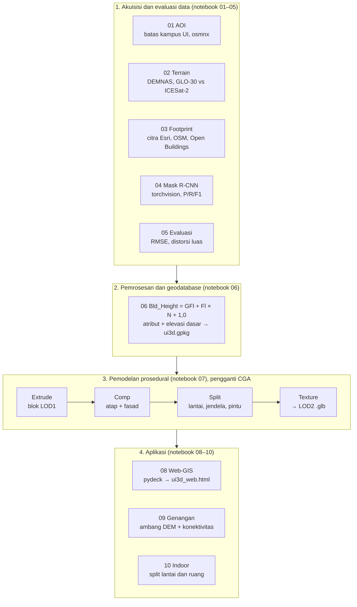

# PRD — 3D City Model & Analisis Spasial Kampus UI Depok (Full Python, Google Colab)

15 Oktober 2026

## Ringkasan

Proyek ini mereplikasi paper Khayyal, Zeidan & Beshr (2022), *Creation and Spatial Analysis of 3D City Modeling based on GIS Data* (Civil Engineering Journal 8(1), [doi:10.28991/CEJ-2022-08-01-08](http://dx.doi.org/10.28991/CEJ-2022-08-01-08)), dengan studi kasus **Kampus Universitas Indonesia, Depok**. Seluruh pipeline berjalan **100% di Python dalam Google Colab** dengan **data gratis**, tanpa QGIS, ArcGIS, Global Mapper, atau CityEngine.

Algoritma, metode evaluasi, input, dan output dibuat setara dengan paper:

- **Terrain**: DEM gratis dibandingkan dengan data referensi yang lebih akurat.
- **Footprint 2D**: dataset hasil digitasi manusia, dataset hasil mesin, dan Mask R-CNN sendiri, semuanya dievaluasi terhadap referensi.
- **Tinggi bangunan**: rumus jumlah lantai.
- **Model 3D**: LOD1/LOD2 secara prosedural; aturan CGA diganti fungsi aturan Python.
- **Aplikasi**: Web 3D, simulasi genangan, dan indoor mapping.

Dokumen ini dipakai sebagai bahan ajar mata kuliah S2 "Konsep analisa data tiga dimensi (3D analysis)", sebagai spesifikasi notebook Colab, dan sebagai sumber untuk NotebookLM.

## Ringkasan paper: masalah, tujuan, solusi

Paper ini menunjukkan bahwa model kota 3D yang cukup akurat bisa dibangun dari data gratis dan procedural modeling, dengan waktu sekitar 20% dari pemodelan manual.

**Latar belakang masalah**

- **Kebutuhan model kota 3D terus meningkat**: model ini menjadi peta dasar untuk smart city dan digital twin, sehingga harus dibuat cepat, akurat, detail, dan murah.
- **Data akurat mahal dan sulit didapat**, terutama di negara berkembang. Survei geodetik seperti total station dan levelling tidak praktis untuk area seluas kota.
- **Data gratis belum teruji akurasinya**: DEM, citra satelit, dan ekstraksi otomatis berbasis deep learning tersedia, tetapi kualitasnya belum jelas.
- **Pemodelan 3D manual lambat** dan sulit diperbarui ketika desain berubah.

**Tujuan penelitian**

1. Membuat model kota 3D (LOD1–LOD2) dari citra satelit dan data GIS gratis.
2. Mengevaluasi akurasi data gratis (DEM, digitasi citra) terhadap survei geodetik lapangan.
3. Menguji deep learning (Mask R-CNN) sebagai alternatif ekstraksi fitur otomatis untuk area luas.
4. Memvalidasi kegunaan model lewat aplikasi: publikasi Web-GIS, simulasi dampak banjir, dan indoor mapping.

**Solusi yang ditawarkan**

- **Data**: terrain dari DEM gratis, footprint dari citra 30 cm. Footprint diambil dengan dua cara, digitasi manual dan Mask R-CNN, lalu keduanya dibandingkan dengan total station.
- **Penyimpanan**: semua data spasial dan atribut disatukan dalam satu geodatabase.
- **Pemodelan**: procedural modeling dengan aturan CGA (Extrude → Comp → Split → Texture). Model dapat dibuat ulang dalam hitungan detik cukup dengan mengubah parameter.
- **Aplikasi**: model dipublikasikan online, lalu dipakai untuk skenario banjir dan indoor mapping.

**Hasil utama**

| Aspek | Hasil |
| --- | --- |
| Terrain (DEM vs levelling) | Selisih maksimum 0,85 m; 90% sel di bawah 0,85 m |
| Footprint digitasi manual | RMSE 3,7 m; distorsi luas 4,61% |
| Footprint deep learning | Distorsi luas 17,12%, terutama akibat bayangan bangunan |
| Mask R-CNN (precision) | Bangunan 0,78; jalan 0,62; lanskap 0,89 |
| Waktu pemodelan | ±20% dari pemodelan manual |

Kesimpulannya, digitasi manual lebih akurat daripada deep learning. Meski begitu, hasil deep learning tetap layak dipakai untuk aplikasi yang tidak menuntut model 3D presisi tinggi.

## Alur presentasi (daftar isi)

Presentasi terdiri dari 14 bagian berurutan, total sekitar 150 menit. Setiap bagian menyebut poin kunci dan gambar paper yang dirujuk, sehingga bisa langsung dijadikan slide atau ringkasan di NotebookLM.

1. **Pengantar 3D city model** (10 menit)
   - Definisi: representasi spasial setiap fitur di atas terrain dalam skala 3D.
   - Level of Detail: LOD0 (footprint 2D), LOD1 (blok atap datar), LOD2 (fasad, jendela, pintu).
   - Peran sebagai peta dasar smart city dan digital twin.
2. **Latar belakang masalah** (5 menit)
   - Kebutuhan model cepat, akurat, dan murah; data akurat mahal; survei lapangan tidak praktis; pemodelan manual lambat.
3. **Tinjauan pustaka singkat** (5 menit)
   - Fotogrametri dan LiDAR untuk rekonstruksi 3D.
   - Procedural modeling dengan CGA (CityEngine).
   - GeoAI: deep learning untuk ekstraksi fitur dari citra satelit.
4. **Tujuan penelitian** (3 menit)
   - Empat tujuan: membuat model, mengevaluasi data gratis, menguji deep learning, dan memvalidasi lewat aplikasi.
5. **Studi kasus Mansoura** (2 menit)
   - Kampus Universitas Mansoura, Mesir: 1,01 km², 19 fakultas, 4 rumah sakit (Fig. 1–2).
6. **Metodologi empat tahap** (5 menit)
   - Akuisisi dan evaluasi data → geodatabase → procedural modeling → aplikasi (Fig. 3).
7. **Akuisisi data** (15 menit)
   - Terrain: DEM dibandingkan dengan grid levelling tiap 30 m (Fig. 4).
   - Footprint: total station (Fig. 5), digitasi manual citra 30 cm (Fig. 6), Mask R-CNN (Fig. 7–8).
   - Tinggi bangunan: Bld_Height = GFl + Fl × N + 1,0.
8. **Pembangkitan model 3D** (10 menit)
   - Procedural vs manual modeling.
   - Rantai CGA: Extrude → Comp → Split → Texture (Fig. 9–10).
   - Hasil LOD1 dan LOD2 (Fig. 11–13).
9. **Web-GIS** (3 menit)
   - Publikasi model sebagai scene layer ke ArcGIS Online; fitur dapat di-identify.
10. **Hasil dan evaluasi** (15 menit)
    - Terrain: selisih maksimum 0,85 m (Fig. 14–15).
    - Footprint: RMSE 3,7 m, distorsi 4,61% (manual) vs 17,12% (deep learning) (Fig. 19, Tabel 2).
    - Mask R-CNN: precision, recall, dan F1 per kelas (Tabel 1, Fig. 16–18).
11. **Aplikasi** (10 menit)
    - Kota baru New Mansoura: tahap pertama dirender dalam 70 detik (Fig. 20).
    - Simulasi banjir: ModelBuilder dan jumlah gedung terdampak per level muka air (Fig. 21–24).
    - Indoor mapping per lantai dan ruang (Fig. 25).
12. **Kesimpulan paper** (5 menit)
    - Procedural modeling cepat dan mudah diperbarui.
    - Digitasi manual lebih akurat daripada deep learning; bayangan dan resolusi citra adalah penyebab utama distorsi.
    - Kelemahan: ukuran file ekspor (OBJ, DAE) besar.
13. **Diskusi kritis** (15 menit)
    - Simulasi banjir hanya model ambang ("bathtub") tanpa hidrologi; label MSL menyesatkan.
    - RMSE 3,7 m dipengaruhi relief displacement: yang terdigitasi atap, bukan dasar bangunan.
    - Training hanya 8 epoch; konstanta +1,0 m pada rumus tinggi tidak dijelaskan.
    - Kesalahan kecil: "P" pada Fig. 7 adalah feature pyramid, bukan pooling; Fig. 4 tertulis "Figure 1".
14. **Replikasi Indonesia: Kampus UI Depok** (45 menit)
    - Pemetaan paper ke Python dan sumber data gratis (lihat bagian berikutnya).
    - Demo notebook 01–03 live; hasil notebook 04–10 dari checkpoint.
    - Pertanyaan diskusi dan tugas mahasiswa.

## Tujuan, non-tujuan, dan kriteria sukses

Target akhirnya: satu set notebook Colab yang bisa dijalankan ulang dari nol oleh mahasiswa dan menghasilkan model 3D Kampus UI beserta tiga analisis spasial.

**Tujuan**

1. Mengevaluasi akurasi DEM gratis terhadap data referensi elevasi, setara Fig. 14–15 paper.
2. Mengevaluasi footprint bangunan dari beberapa sumber terhadap referensi (RMSE, distorsi luas), setara Tabel 2.
3. Melatih dan menguji Mask R-CNN untuk kelas bangunan, jalan, vegetasi, dan air (precision, recall, F1), setara Tabel 1.
4. Menghitung tinggi bangunan dengan rumus paper dan menyimpannya di geodatabase (GeoPackage).
5. Membangun model 3D LOD1 dan LOD2 secara prosedural dengan aturan berbasis parameter.
6. Menjalankan tiga aplikasi: Web 3D, simulasi genangan, dan indoor mapping satu gedung.

**Non-tujuan**

- Bukan model hidrologi/hidrolika banjir yang sebenarnya; simulasi genangan tetap tipe ambang elevasi seperti paper, dengan satu perbaikan konektivitas.
- Bukan survei lapangan baru; referensi memakai data terbuka (opsional: data GNSS/total station bila tersedia).
- Bukan tekstur foto fasad yang realistis per gedung; LOD2 memakai fasad generik (lantai, jendela, pintu).

**Kriteria sukses**

| Kriteria | Ukuran |
| --- | --- |
| Reproducible | Semua notebook jalan "Run all" di Colab gratis tanpa error |
| Tanpa aplikasi eksternal | Tidak ada langkah di luar Python, kecuali unduh/unggah file lewat browser |
| Data gratis | Semua sumber berlisensi terbuka atau gratis untuk pendidikan |
| Output lengkap | Grafik evaluasi, GeoPackage, file 3D (glTF/OBJ), HTML Web 3D, grafik banjir |
| Durasi | Seluruh pipeline selesai < 3 jam di GPU T4 Colab (termasuk training) |

## Pemetaan paper ke implementasi Python

Setiap perangkat lunak di paper diganti library Python, sementara algoritma dan metriknya tetap sama.

| Tahap paper | Di paper | Pengganti Python | Algoritma tetap |
| --- | --- | --- | --- |
| Unduh citra | Global Mapper | `leafmap` / `segment-geospatial` (`tms_to_geotiff`), `rasterio` | Mosaik tile citra resolusi tinggi |
| Terrain | DEM 12,5 m + grid levelling | `rasterio`, `rioxarray`, `scipy.interpolate` | Interpolasi titik ke grid, selisih raster, histogram |
| Digitasi manual | ArcMap/QGIS | Footprint OSM (`osmnx`), hasil digitasi manusia | Dibandingkan dengan referensi |
| Ekstraksi otomatis | Mask R-CNN (TF/Keras) | Mask R-CNN `torchvision` (ResNet50-FPN) | Instance segmentation dua tahap |
| Evaluasi footprint | RMSE + distorsi luas | `geopandas`, `shapely`, `numpy` | RMSE (Pers. 2), distorsi (Tabel 2) |
| Metrik DL | Precision, Recall, F1 | `pycocotools` / `torchmetrics` | Pers. 3–5, IoU ≥ 0,5 |
| Tinggi | Rumus jumlah lantai | `pandas` | `H = GFl + Fl × N + 1,0` (Pers. 1) |
| Geodatabase | ArcGIS geodatabase | GeoPackage (`geopandas`) | Atribut spasial + non-spasial |
| Procedural modeling | CityEngine + CGA | `shapely` + `trimesh` + fungsi aturan Python | Extrude → Comp → Split → Texture |
| Web-GIS | ArcGIS Online (.slpk) | `pydeck` → HTML, ekspor glTF | Publikasi model 3D interaktif |
| Banjir | ModelBuilder (Topo to Raster, Fill, Int, Extract, Raster to Polygon) | `numpy`, `scipy.ndimage`, `rasterio.features`, `geopandas` | Ambang elevasi → poligon → bangunan terdampak |
| Indoor | CGA split lantai/ruang | `shapely` + `trimesh` + atribut | Split per lantai dan ruang |

Rumus yang dipakai, persis seperti paper:

$$H_{bld} = H_{GF} + H_{floor} \times N + 1.0$$

$$RMSE = \sqrt{\frac{1}{n}\sum d^2}$$

$$Precision = \frac{TP}{TP+FP},\quad Recall = \frac{TP}{TP+FN},\quad F1 = 2\times\frac{Precision \times Recall}{Precision + Recall}$$

$$Distorsi = \frac{A_{ref} - A_i}{A_{ref}} \times 100\%$$

## Sumber data gratis dan cara akses dari Colab

Semua data di bawah gratis. Hanya DEMNAS yang perlu diunduh manual lewat browser lalu diunggah ke Google Drive; sisanya ditarik langsung dari Python.

| Peran (setara paper) | Dataset | Resolusi / jenis | Akses dari Python | Catatan |
| --- | --- | --- | --- | --- |
| DEM utama (pengganti DEM NASA) | [DEMNAS BIG](https://www.big.go.id/en/content/produk/demnas) | 0,27" (~8 m), datum EGM2008 | Unduh tile di [tanahair.indonesia.go.id/demnas](https://tanahair.indonesia.go.id/demnas/#/), unggah ke Drive, baca `rasterio` | Perlu login portal; pilih tile yang mencakup Depok |
| DEM pembanding | Copernicus DEM GLO-30 | 30 m, DSM | `pystac-client` + `planetary-computer` (tanpa key) | DSM: bangunan dan pohon ikut terukur |
| Referensi elevasi (pengganti grid levelling) | ICESat-2 ATL08 (`h_te_best_fit`) | Titik lidar satelit, segmen 100 m | `earthaccess` + `h5py` | Akun NASA Earthdata gratis; konversi ellipsoid → EGM2008 dengan `pyproj` |
| Referensi footprint (pengganti total station) | OpenStreetMap buildings | Vektor, digitasi manusia | `osmnx.features_from_polygon` | Verifikasi visual sampel 20–30 gedung terhadap citra |
| Footprint pembanding (hasil mesin) | Google Open Buildings v3 polygons | Vektor + confidence | Unduh tile CSV dari Google Cloud Storage via `pandas` | Pembanding "dataset ML siap pakai" |
| Citra resolusi tinggi (pengganti citra 30 cm) | Esri World Imagery (XYZ tile) | ~0,3–0,6 m di perkotaan | `segment-geospatial`/`leafmap` `tms_to_geotiff` | Hanya untuk pendidikan/riset non-komersial; cek syarat layanan |
| Tinggi bangunan / jumlah lantai | OSM `building:levels` + Google Open Buildings 2.5D Temporal | Atribut + raster tinggi 4 m efektif | `osmnx`; `earthengine-api` (akun EE gratis) | Tinggi raster dikonversi ke N lantai bila tag kosong |
| Batas studi (AOI) | Poligon kampus UI di OSM | Vektor | `osmnx.geocode_to_gdf("Universitas Indonesia, Depok")` | Fallback: bbox manual |

Dua catatan penting untuk diskusi kelas:

- DEMNAS dan Copernicus sama-sama berbasis radar sehingga mendekati DSM; selisih dengan ICESat-2 (tanah) juga mencerminkan tinggi vegetasi dan bangunan, bukan hanya galat.
- Google Open Buildings 2.5D melaporkan MAE tinggi sekitar 1,5 m dari spot check ([Google Research](https://research.google/blog/open-buildings-25d-temporal-dataset-tracks-building-changes-across-the-global-south/)), sehingga cukup untuk mengestimasi jumlah lantai, bukan tinggi presisi.

Untuk konteks akurasi, studi pembanding di Bogor mencatat RMSE vertikal DEMNAS 8,17 m terhadap GPS, dengan galat yang relatif seragam di semua rentang elevasi ([Susetyo, 2023](https://doi.org/10.3846/gac.2023.18168)).

## Arsitektur pipeline dan struktur folder

Empat tahap paper (Fig. 3) dipertahankan; tiap tahap dipecah menjadi notebook yang membaca output tahap sebelumnya dari Drive.



Ringkasnya: (1) akuisisi dan evaluasi data, notebook 01–05 → (2) geodatabase, notebook 06 → (3) pemodelan prosedural Extrude → Comp → Split → Texture, notebook 07 → (4) aplikasi Web-GIS, genangan, dan indoor, notebook 08–10.

```text
ui3d/
├── config.yaml
├── notebooks/        00_setup … 10_indoor (.ipynb)
├── raw/              DEMNAS, ATL08 (.h5), ui_rgb.tif
├── interim/          chip latih, raster antara
├── models/           maskrcnn_ui.pt (checkpoint per epoch)
├── output/           ui3d.gpkg, ui_lod1.glb, ui_lod2.glb, ui3d_web.html
└── figures/          padanan Fig. 1–25 paper
```

## Langkah-langkah implementasi

Pipeline terdiri dari 11 notebook (00–10). Setiap langkah menulis output ke Google Drive agar notebook berikutnya bisa jalan terpisah. CRS kerja: **UTM 48S (EPSG:32748)**.

### Langkah 0 — Setup lingkungan (`00_setup.ipynb`)

1. Mount Google Drive, buat folder `ui3d/{raw,interim,output,models,figures}`.
2. Instal library:

```python
!pip install -q geopandas osmnx rasterio rioxarray shapely trimesh mapbox-earcut \
  pydeck pystac-client planetary-computer earthaccess h5py pyproj \
  segment-geospatial pycocotools torchmetrics scikit-image plotly
```

3. Simpan parameter global di `config.yaml`: CRS, path, tinggi lantai dasar (`GFl = 4,0 m`), tinggi lantai (`Fl = 3,5 m`), konstanta +1,0 m, level muka air banjir.
4. Pilih runtime GPU (T4) untuk Langkah 4.

### Langkah 1 — Area studi (`01_aoi.ipynb`)

- **Input**: nama tempat.
- **Proses**: `osmnx.geocode_to_gdf("Universitas Indonesia, Depok")`, proyeksikan ke EPSG:32748, buffer 50 m; fallback bbox manual bila poligon tidak ditemukan.
- **Output**: `aoi.gpkg`, luas AOI (ha/km²), peta lokasi (setara Fig. 1–2).

### Langkah 2 — Terrain dan evaluasinya (`02_terrain.ipynb`)

1. Baca DEMNAS dari Drive, clip ke AOI + buffer 3 km, reproject dan resample ke grid 8 m.
2. Ambil Copernicus GLO-30 dari Planetary Computer, samakan grid.
3. Unduh ICESat-2 ATL08 untuk bbox Depok dengan `earthaccess`; baca tiap beam (`gt1l`…`gt3r`): `land_segments/latitude`, `longitude`, `terrain/h_te_best_fit`. Buang nilai fill dan segmen ber-uncertainty tinggi.
4. Konversi tinggi ICESat-2 dari ellipsoid WGS84 ke EGM2008 agar sama dengan DEMNAS:

```python
from pyproj import Transformer
t = Transformer.from_crs("EPSG:4979", "EPSG:4326+3855", always_xy=True)
lon, lat, h_egm = t.transform(lon, lat, h_ellps)
```

5. Sampling DEM di titik ICESat-2, hitung selisih `ΔZ = Z_DEM − Z_ICESat2`.
6. Statistik setara paper: min/maks, % titik < 0,2 / 0,4 / 0,65 / 0,85 m, RMSE, LE90, histogram kelas 0,2 m (setara Fig. 15) dan scatter selisih (setara Fig. 14).
7. Visual permukaan 3D terrain dengan `plotly.graph_objects.Surface` (setara Fig. 4).

- **Output**: `dem_ui_8m.tif`, `terrain_eval.csv`, 3 figure.

### Langkah 3 — Citra dan footprint referensi (`03_imagery_footprint.ipynb`)

1. Unduh citra Esri World Imagery untuk AOI, zoom 19, dengan `tms_to_geotiff` → `ui_rgb.tif` (8-bit, 3 band, sesuai syarat model di paper).
2. Ambil footprint OSM (`building=*`), jalan (`highway=*`), air (`natural=water`), vegetasi (`landuse=grass/forest`, `leisure=park`).
3. Bersihkan geometri: `make_valid`, explode multipolygon, buang < 10 m².
4. Ambil Google Open Buildings v3 untuk AOI, filter confidence ≥ 0,75.
5. Verifikasi visual 20–30 gedung OSM di atas citra; tandai yang tidak sesuai.

- **Output**: `ref_buildings.gpkg`, `gob_buildings.gpkg`, layer jalan/air/vegetasi, peta tematik per kategori (setara Fig. 5–6).

### Langkah 4 — Mask R-CNN (`04_maskrcnn.ipynb`)

1. **Siapkan data latih**: potong citra jadi chip 512×512 px; rasterisasi layer OSM jadi instance mask per objek. Kelas: Bangunan, Jalan (garis di-buffer sesuai lebar), Vegetasi, Air.
2. **Split 80/20** seperti paper, tetapi per blok spasial agar chip latih dan validasi tidak bertetangga.
3. **Model**: `torchvision` Mask R-CNN ResNet50-FPN pretrained COCO, ganti head untuk 5 kelas (latar + 4):

```python
from torchvision.models.detection import maskrcnn_resnet50_fpn_v2
from torchvision.models.detection.faster_rcnn import FastRCNNPredictor
from torchvision.models.detection.mask_rcnn import MaskRCNNPredictor
m = maskrcnn_resnet50_fpn_v2(weights="DEFAULT")
m.roi_heads.box_predictor = FastRCNNPredictor(1024, 5)
m.roi_heads.mask_predictor = MaskRCNNPredictor(256, 256, 5)
```

4. **Latih**: jalankan 8 epoch sebagai replikasi paper, lalu 25 epoch sebagai pembanding. Catat loss latih dan validasi per batch (setara Fig. 18).
5. **Evaluasi**: Precision, Recall, F1 per kelas pada IoU ≥ 0,5 (setara Tabel 1); contoh deteksi (setara Fig. 16–17).
6. **Inferensi** seluruh AOI dengan sliding window, gabungkan mask, ubah jadi poligon dengan `rasterio.features.shapes`, simplify 0,5 m.

- **Output**: `maskrcnn_ui.pt`, `dl_buildings.gpkg`, raster klasifikasi AOI (setara Fig. 8), `dl_metrics.csv`.

### Langkah 5 — Evaluasi footprint (`05_footprint_eval.ipynb`)

1. Cocokkan tiap gedung referensi dengan kandidat (GOB, Mask R-CNN) berdasarkan IoU tertinggi.
2. Hitung jarak `d` antar pasangan: pergeseran centroid dan jarak rata-rata vertex ke batas referensi; lalu RMSE (Pers. 2).
3. Hitung distorsi luas total per sumber (setara Tabel 2).
4. Peta overlay pergeseran (setara Fig. 19) dan analisis penyebab: relief displacement atap, bayangan, kanopi pohon.
5. Opsional: bila ada data GNSS RTK/total station sudut gedung, jadikan referensi utama dan OSM ikut dievaluasi.

- **Output**: tabel RMSE dan distorsi, peta pergeseran.

### Langkah 6 — Tinggi bangunan dan geodatabase (`06_height_gdb.ipynb`)

1. Jumlah lantai `N`: dari OSM `building:levels`; bila kosong, dari median tinggi Open Buildings 2.5D di dalam footprint, `N = max(1, round((h − GFl) / Fl) + 1)`.
2. Tinggi: `Bld_Height = GFl + Fl × N + 1,0` (Pers. 1); simpan juga sumber nilai `N`.
3. Elevasi dasar gedung = statistik zonal DEM (persentil 10) di footprint, agar gedung menempel ke terrain.
4. Atribut non-spasial: nama, kategori (fakultas, rumah sakit, masjid, olahraga, asrama, fasilitas umum), sumber footprint.
5. Tulis semua layer ke satu GeoPackage `ui3d.gpkg`.

- **Output**: `ui3d.gpkg` (aoi, buildings, roads, water, vegetation, terrain_points).

### Langkah 7 — Pemodelan prosedural 3D (`07_procedural.ipynb`)

Aturan CGA diganti "rule file" Python: satu dict/YAML per kategori (tinggi lantai, lebar jendela, rasio jendela, warna fasad), dijalankan oleh fungsi berurutan seperti CGA.

1. `extrude(footprint, H)` → blok **LOD1** dengan `trimesh.creation.extrude_polygon`, digeser ke elevasi dasar.
2. `comp(block)` → pisahkan atap dan fasad dari normal permukaan.
3. `split_floors(facade, Fl)` → potong fasad per lantai.
4. `split_tiles(floor, w)` → bagi tiap lantai jadi tile dinding/jendela/pintu; pintu di lantai dasar fasad terpanjang; jendela sebagai kotak tipis inset 0,15 m → **LOD2**.
5. `texture(mesh)` → warna/UV dengan tekstur fasad generik yang dibuat sendiri di PIL (bukan foto berhak cipta).
6. Terrain DEM jadi mesh; jalan dan air di-drape di atas terrain; pohon sederhana opsional.
7. Ekspor `ui_lod1.glb`, `ui_lod2.glb`, `.obj`; catat waktu generate untuk dibandingkan dengan klaim efisiensi paper.

- **Output**: model LOD1 (setara Fig. 12) dan LOD2 (setara Fig. 11b, 13), viewer 3D di notebook.

### Langkah 8 — Web-GIS (`08_webgis.ipynb`)

1. `pydeck` `PolygonLayer` dengan `extruded=True`, `get_elevation=Bld_Height`, warna per kategori, tooltip atribut (pengganti popup identify ArcGIS Online).
2. Opsional `ScenegraphLayer` untuk memuat `ui_lod2.glb`.
3. `deck.to_html("ui3d_web.html")` → satu file HTML yang bisa dibuka di browser atau dihosting statis.

- **Output**: `ui3d_web.html`.

### Langkah 9 — Simulasi genangan (`09_flood.ipynb`)

Rantai ModelBuilder paper diterjemahkan satu per satu:

| ModelBuilder (paper) | Python |
| --- | --- |
| Topo to Raster | DEM 8 m dari Langkah 2 (opsional: interpolasi ulang dengan `scipy.interpolate.griddata`) |
| Fill | `skimage.morphology.reconstruction` (isi cekungan) |
| Int | `np.floor(dem)` |
| Extract by Attributes | `mask = dem_int <= level` |
| Raster to Polygon | `rasterio.features.shapes` → `geopandas` |
| CGA `touches(all, "water14")` | `geopandas.sjoin(buildings, flood, predicate="intersects")` |

1. Tentukan rentang level muka air dari persentil DEM di AOI, langkah 1 m.
2. Perbaikan atas paper: hanya sel yang terhubung ke sumber air (danau UI) yang dihitung tergenang, dengan `scipy.ndimage.label`.
3. Karena DEM bersifat DSM, piksel bangunan dimasking lalu diinterpolasi dulu agar mendekati DTM.
4. Hitung jumlah gedung terdampak per level (setara Fig. 23); peta merah/kuning (setara Fig. 24) dan versi 3D di pydeck.

- **Output**: `flood_levels.gpkg`, `flood_impact.csv`, grafik dan peta.

### Langkah 10 — Indoor mapping (`10_indoor.ipynb`)

1. Pilih satu gedung dengan footprint OSM yang baik (misalnya gedung dekanat di FT).
2. Split per lantai sesuai `N` dan `Fl`.
3. Tiap lantai: koridor di sumbu panjang `minimum_rotated_rectangle`, ruang di kedua sisi dengan lebar ±6 m.
4. Atribut: `BlockName`, `BlockNo`, `FloorNo`, `RoomNo`, `RoomUse` (asumsi atau data denah bila ada).
5. Visual 3D dengan tooltip identify (setara Fig. 25) dan contoh query: "ruang lab di lantai 2".

- **Output**: `indoor_<gedung>.gpkg`, model 3D per lantai.

## Metrik evaluasi dan deliverable

Setiap hasil di paper punya padanan yang bisa dibandingkan langsung di kelas.

| Output | Metrik | Nilai paper (Mansoura) | Padanan UI |
| --- | --- | --- | --- |
| Evaluasi terrain | Selisih maks., % < 0,85 m, RMSE | Maks. 0,85 m; 90% < 0,85 m | DEMNAS vs ICESat-2, Copernicus vs ICESat-2 |
| Footprint manual | RMSE, distorsi luas | RMSE 3,7 m; distorsi 4,61% | OSM sebagai referensi (atau GNSS bila ada) |
| Footprint deep learning | Distorsi luas | 17,12% | Mask R-CNN dan Google Open Buildings |
| Mask R-CNN bangunan | P / R / F1 | 0,78 / 0,86 / 0,82 | Tabel per kelas, 8 vs 25 epoch |
| Mask R-CNN jalan | P / R / F1 | 0,62 / 0,875 / 0,73 | idem |
| Mask R-CNN lanskap | P / R / F1 | 0,89 / 0,96 / 0,93 | idem + kelas air |
| Model 3D | Waktu generate | ±20% waktu manual | Waktu run `07_procedural` |
| Banjir | Gedung terdampak per level | Grafik per MSL | Grafik per level muka air |

**Deliverable**

- [ ] 11 notebook Colab (00–10) + `config.yaml`
- [ ] `ui3d.gpkg` (geodatabase lengkap)
- [ ] `ui_lod1.glb`, `ui_lod2.glb`, `.obj`
- [ ] `ui3d_web.html` (Web 3D interaktif)
- [ ] Tabel evaluasi: terrain, footprint, Mask R-CNN
- [ ] Grafik dan peta banjir
- [ ] Model indoor satu gedung
- [ ] Folder `figures/` berisi padanan Fig. 1–25 paper

## Risiko, keterbatasan, dan mitigasi

Risiko terbesar ada di data referensi: tanpa survei lapangan, "ground truth" diganti data terbuka yang juga punya galat.

| Risiko | Dampak | Mitigasi |
| --- | --- | --- |
| Track ICESat-2 yang melintasi kampus UI sedikit | Statistik terrain lemah | Perluas area evaluasi ke Depok (buffer 3–5 km); laporkan jumlah titik |
| DEMNAS dan Copernicus bersifat DSM | Selisih tercampur tinggi pohon/gedung | Masking bangunan dan vegetasi sebelum evaluasi; bahas di kelas |
| OSM tidak lengkap atau tergeser | Referensi footprint bias | Verifikasi visual sampel; opsi survei GNSS RTK beberapa gedung |
| Kanopi pohon menutupi atap di UI | Recall bangunan Mask R-CNN turun | Laporkan sebagai temuan, sejalan dengan isu bayangan di paper |
| Kelas jalan dan vegetasi bukan objek "instance" | Metrik jalan rendah (paper juga 0,62) | Ikuti paper, catat semantic segmentation sebagai alternatif |
| Syarat layanan tile citra Esri | Pembatasan pemakaian | Hanya untuk pendidikan; jangan distribusikan ulang citranya |
| Batas GPU/RAM Colab gratis | Training terputus | Checkpoint per epoch ke Drive; chip 512 px, batch 2 |
| Akun Earthdata/Earth Engine belum ada | Langkah 2 dan 6 tertunda | Daftar sebelum kelas; sediakan file hasil unduhan cadangan di Drive |
| Simulasi genangan berbasis ambang | Bukan prediksi banjir sebenarnya | Sebut eksplisit sebagai skenario visual; pembanding: model hidrologi |

## Rencana jadwal dan catatan kelas S2

Untuk kelas Senin, cukup siapkan Langkah 0–3 yang sudah jalan dan hasil Langkah 4–10 yang sudah di-render; training tidak perlu live.

**Sebelum kelas**

- [ ] Daftar akun NASA Earthdata, Google Earth Engine, dan portal DEMNAS
- [ ] Unduh tile DEMNAS area Depok ke Drive
- [ ] Jalankan semua notebook sekali; simpan checkpoint model dan output di Drive
- [ ] Siapkan salinan notebook "read-only" untuk mahasiswa

**Alur sesi (±150 menit)**

Ikuti bagian **Alur presentasi** di atas: bagian 1–13 membahas paper (±105 menit), bagian 14 untuk demo replikasi UI Depok (±45 menit).

**Pertanyaan diskusi**

- Apakah ICESat-2 dan OSM layak menjadi "ground truth"? Apa konsekuensinya terhadap angka RMSE?
- Mengapa distorsi deep learning lebih besar dari digitasi manual, dan apakah hasilnya sama di UI yang rimbun?
- Apa batas model genangan berbasis ambang untuk kampus dengan banyak danau?
- Kapan LOD1 sudah cukup, dan kapan LOD2 benar-benar dibutuhkan?

**Tugas mahasiswa (opsional)**: replikasi pipeline untuk kampus lain (mis. IPB Dramaga atau ITB Jatinangor) dan bandingkan metriknya dengan UI.

**Sumber**

- [Khayyal, Zeidan & Beshr (2022), Civil Engineering Journal 8(1)](http://dx.doi.org/10.28991/CEJ-2022-08-01-08)
- [BIG — DEMNAS](https://www.big.go.id/en/content/produk/demnas)
- [Susetyo (2023), akurasi vertikal DEMNAS, SRTM-1, ASTER GDEM](https://doi.org/10.3846/gac.2023.18168)
- [Google Earth Engine — Open Buildings 2.5D Temporal](https://developers.google.com/earth-engine/datasets/catalog/GOOGLE_Research_open-buildings-temporal_v1)
- [Google Research — Open Buildings 2.5D Temporal](https://research.google/blog/open-buildings-25d-temporal-dataset-tracks-building-changes-across-the-global-south/)
- [Wang dkk. (2025), verifikasi DEM dengan ICESat-2 ATL08](https://isprs-archives.copernicus.org/articles/XLVIII-4-W14-2025/305/2025/)
