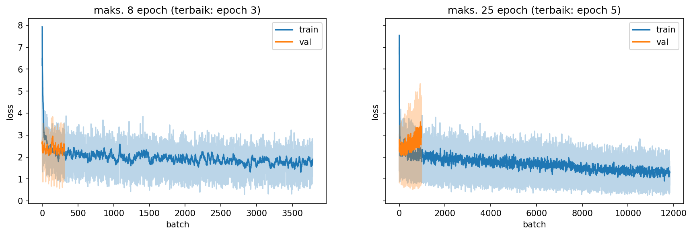
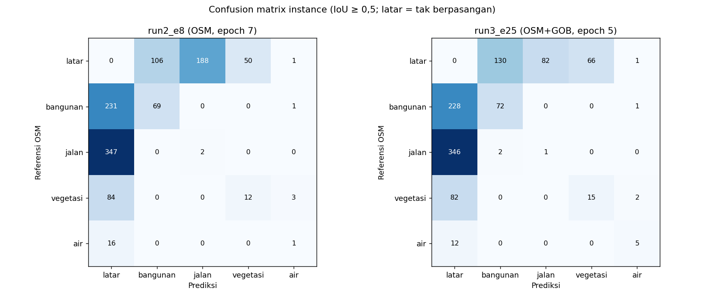
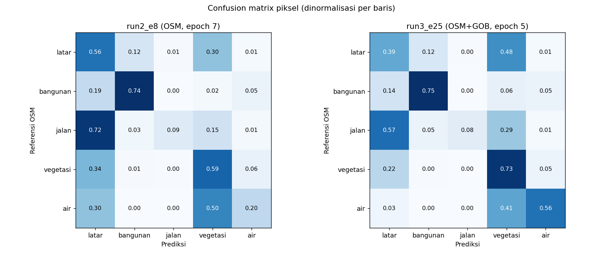
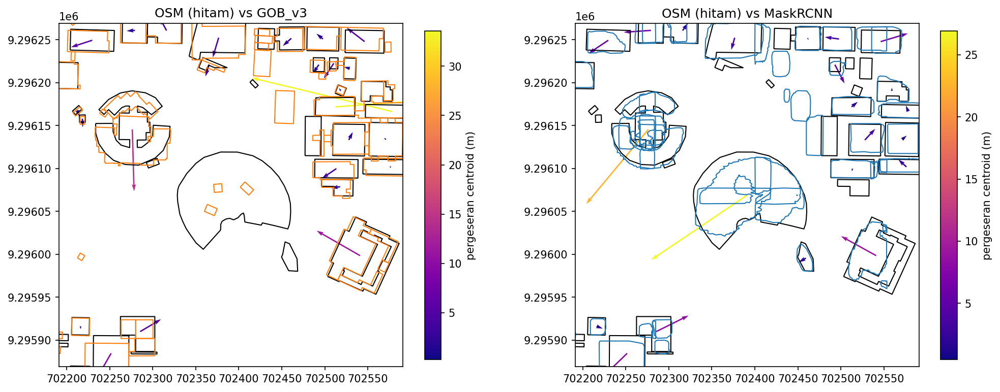
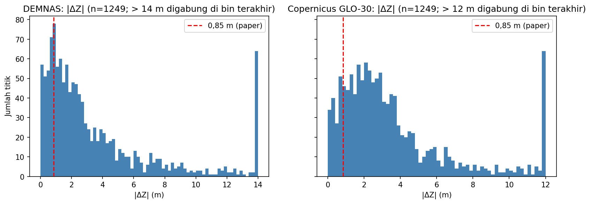
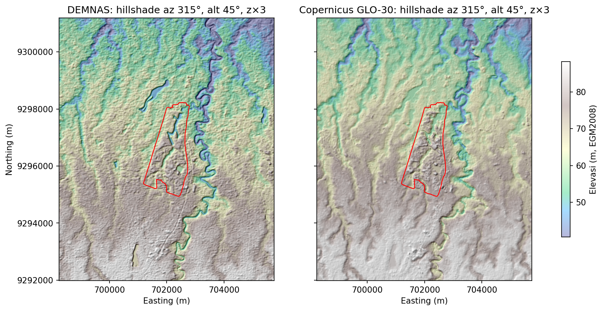
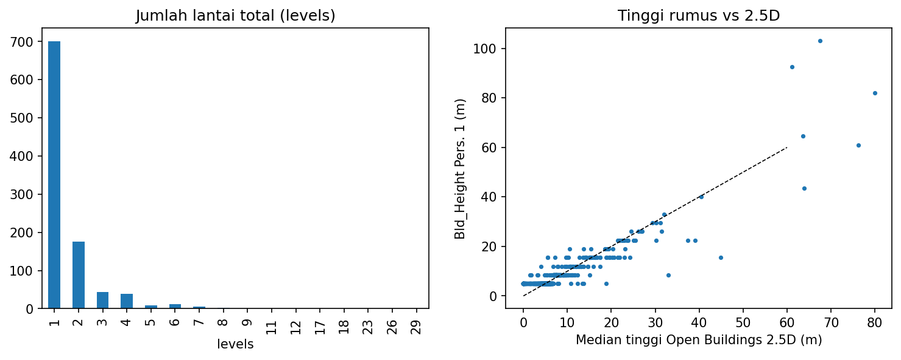
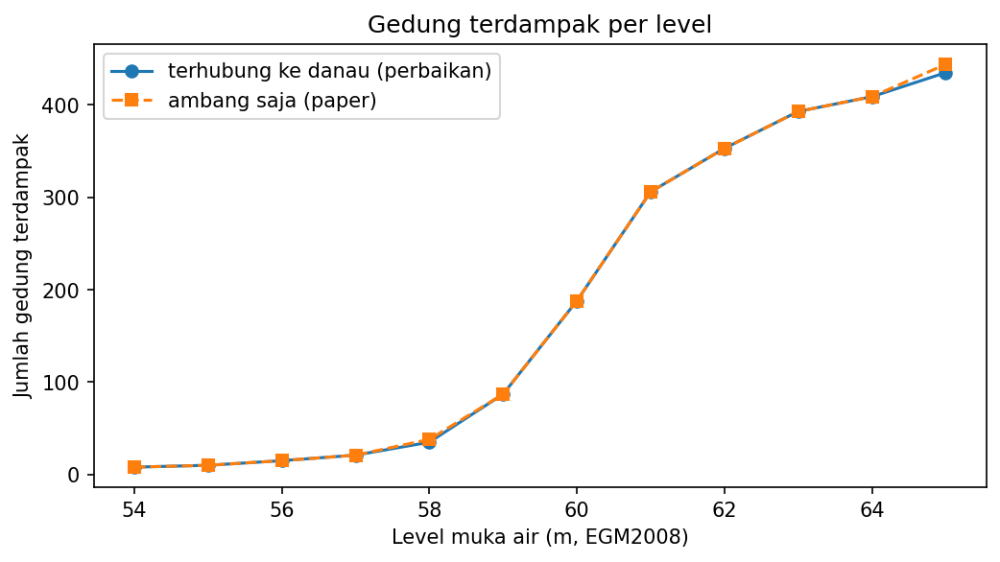
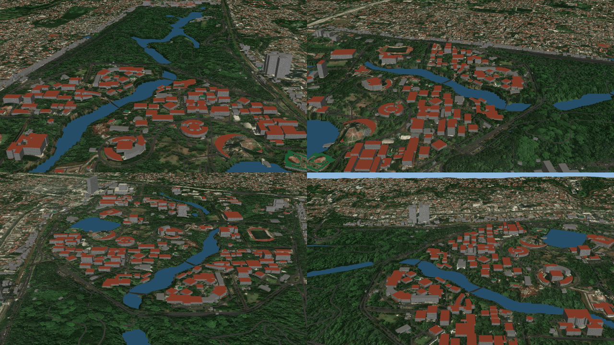
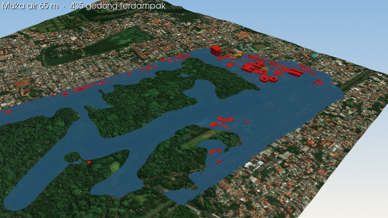

# Laporan Validasi dan Performa — 3D City Model Kampus UI Depok

Tanggal: 16 Oktober 2026, visualisasi diperbarui 19 Oktober 2026 (§4, §6). Replikasi Khayyal, Zeidan & Beshr (2022)
dengan data terbuka, dijalankan lokal (notebook 00–11). Pembaruan 19 Oktober hanya mengubah visual; semua angka evaluasi
tetap sama.

## Ringkasan

- **995 gedung** OSM berhasil dipetakan, diberi tinggi, dan dimodelkan 3D (LOD1 dan LOD2). Tidak ada gedung yang gagal.
- **Footprint Google Open Buildings v3** setara paper: RMSE jarak vertex **3,72 m** (paper 3,7 m), distorsi luas pasangan −0,36% (paper 4,61%).
- **Tinggi gedung** dari rumus Pers. 1 cocok dengan Open Buildings 2.5D: median selisih +0,52 m, MAE 1,87 m.
- **Mask R-CNN** jauh di bawah paper di level instance: F1 bangunan 0,27–0,29 (paper 0,82). Di level piksel jauh lebih baik: F1 bangunan **0,61–0,62**, recall 74–75%. Model menemukan sebagian besar atap, tetapi bentuk instance-nya (gedung terpecah atau tergabung) sering gagal mencapai IoU ≥ 0,5.
- **Terrain** tidak mencapai angka paper (90% titik < 0,85 m). DEMNAS dan Copernicus adalah DSM radar, sedangkan referensi ICESat-2 mengukur tanah di bawah kanopi; RMSE ±7,6 m sebagian besar mencerminkan tinggi pohon dan atap.
- **Menambah label GOB v3 ke data latih (run 3) tidak memperbaiki model** secara berarti. Kenaikan kecil di piksel diimbangi penurunan di footprint (distorsi total area validasi −29,7% → −55,1%).

## 1. Riwayat run

| Run | Perubahan | Model terpilih |
| --- | --- | --- |
| Run 1 | Pipeline awal: chip 512 tanpa overlap (117 latih / 54 validasi), flip horizontal, bobot epoch terakhir, gabung poligon antar-window dengan `unary_union`, rumus N = jumlah lantai total | e8 (epoch 8) |
| Run 2 | Chip latih stride 256 (473 latih / 39 validasi, tanpa menyentuh blok validasi), rotasi 90° + flip, bobot = epoch dengan loss validasi terendah, NMS antar-window, N = lantai di atas lantai dasar, statistik NMAD, banjir p2–p20, indoor Dekanat FTUI | e8 (epoch 7) |
| Run 3 | Seperti run 2 + 355 gedung GOB v3 yang tidak tumpang tindih OSM ditambahkan ke label bangunan | e25 (epoch 5) |

Output di `output/` saat ini berasal dari **run 3**. Model run 1 dan run 2 tersimpan di `models/_old_run/` dan `models/_run2/`.

Catatan perbandingan: run 1 memakai split validasi berbeda (309 gedung referensi), jadi angkanya hanya indikatif. Run 2 dan run 3 memakai area validasi yang **identik** (39 chip, 249 gedung referensi), sehingga dapat dibandingkan langsung.

## 2. Mask R-CNN

### 2.1 Kurva latih

| Run | Epoch maks. | Loss validasi terendah | Epoch terbaik |
| --- | --- | --- | --- |
| Run 2 | 8 | 2,185 | 7 |
| Run 2 | 25 | — | 3 |
| Run 3 | 8 | 2,211 | 3 |
| Run 3 | 25 | — | 5 |

Pada semua run 25 epoch, loss latih terus turun sementara loss validasi naik setelah epoch 3–5: model overfit. Penyebab utamanya adalah ukuran data: seluruh AOI hanya ±3 km² (473 chip latih yang saling tumpang tindih).

### 2.2 Precision, Recall, F1 per kelas (instance, IoU mask ≥ 0,5, skor ≥ 0,5)

Dievaluasi di 39 chip validasi yang sama. Referensi = label OSM (sama dengan referensi paper).

| Model | Kelas | TP | FP | FN | Precision | Recall | F1 | Paper P / R / F1 |
| --- | --- | --- | --- | --- | --- | --- | --- | --- |
| Run 2 e8 | bangunan | 69 | 106 | 232 | **0,394** | 0,229 | **0,290** | 0,78 / 0,86 / 0,82 |
| Run 2 e8 | jalan | 2 | 188 | 347 | 0,011 | 0,006 | 0,007 | 0,62 / 0,875 / 0,73 |
| Run 2 e8 | vegetasi | 12 | 50 | 87 | 0,194 | 0,121 | 0,149 | 0,89 / 0,96 / 0,93 |
| Run 2 e8 | air | 1 | 5 | 16 | 0,167 | 0,059 | 0,087 | — |
| Run 2 e25 | bangunan | 76 | 194 | 225 | 0,281 | 0,252 | 0,266 | |
| Run 2 e25 | air | 4 | 4 | 13 | 0,500 | 0,235 | 0,320 | |
| Run 3 e8 | bangunan | 71 | 148 | 230 | 0,324 | 0,236 | 0,273 | |
| Run 3 e25 | bangunan | 72 | 132 | 229 | 0,353 | 0,239 | 0,285 | |
| Run 3 e25 | jalan | 1 | 82 | 348 | 0,012 | 0,003 | 0,005 | |
| Run 3 e25 | vegetasi | 15 | 66 | 84 | 0,185 | 0,152 | 0,167 | |
| Run 3 e25 | air | 5 | 4 | 12 | **0,556** | **0,294** | **0,385** | |

Run 1 (split validasi berbeda, indikatif): F1 bangunan 0,226, jalan 0,006, vegetasi 0,234, air 0,452.

Bila referensi diperluas menjadi OSM + GOB, F1 bangunan semua model justru turun (0,23–0,25) karena FN bertambah 115 gedung, sementara TP hanya naik 3–6. Artinya model tidak menemukan gedung-gedung yang hanya ada di GOB. Tabel lengkap: `output/report_eval/prf_val.csv`.

### 2.3 Confusion matrix instance

Baris = referensi OSM, kolom = prediksi. "Latar" di kolom berarti objek referensi tidak ditemukan (FN); "latar" di baris berarti prediksi tanpa pasangan referensi (FP).

Run 2 e8:

| Referensi \ Prediksi | latar | bangunan | jalan | vegetasi | air |
| --- | --- | --- | --- | --- | --- |
| latar | — | 106 | 188 | 50 | 1 |
| bangunan | 231 | **69** | 0 | 0 | 1 |
| jalan | 347 | 0 | **2** | 0 | 0 |
| vegetasi | 84 | 0 | 0 | **12** | 3 |
| air | 16 | 0 | 0 | 0 | **1** |

Run 3 e25:

| Referensi \ Prediksi | latar | bangunan | jalan | vegetasi | air |
| --- | --- | --- | --- | --- | --- |
| latar | — | 130 | 82 | 66 | 1 |
| bangunan | 228 | **72** | 0 | 0 | 1 |
| jalan | 346 | 2 | **1** | 0 | 0 |
| vegetasi | 82 | 0 | 0 | **15** | 2 |
| air | 12 | 0 | 0 | 0 | **5** |

Hampir tidak ada salah kelas antar-objek. Semua galat ada di kolom/baris latar: objek tidak ditemukan atau bentuknya tidak cukup cocok (IoU < 0,5), dan prediksi yang tidak punya pasangan.

### 2.4 Confusion matrix piksel

Tiap piksel diberi kelas dari instance berskor tertinggi; referensi dirasterisasi dari label OSM. Nilai per baris dinormalisasi (recall per kelas).

Run 2 e8 (jumlah piksel):

| Referensi \ Prediksi | latar | bangunan | jalan | vegetasi | air |
| --- | --- | --- | --- | --- | --- |
| latar | 3.162.477 | 698.656 | 46.838 | 1.724.531 | 51.832 |
| bangunan | 205.372 | **801.216** | 2.260 | 16.706 | 52.974 |
| jalan | 712.630 | 27.768 | **90.148** | 145.795 | 13.819 |
| vegetasi | 658.371 | 11.560 | 6.097 | **1.140.328** | 108.580 |
| air | 166.045 | 0 | 0 | 271.304 | **108.309** |

Run 3 e25 (jumlah piksel):

| Referensi \ Prediksi | latar | bangunan | jalan | vegetasi | air |
| --- | --- | --- | --- | --- | --- |
| latar | 2.237.232 | 654.669 | 25.984 | 2.712.256 | 54.193 |
| bangunan | 150.094 | **809.675** | 967 | 64.810 | 52.982 |
| jalan | 567.278 | 47.024 | **83.953** | 283.035 | 8.870 |
| vegetasi | 416.283 | 9.538 | 4.238 | **1.407.901** | 86.976 |
| air | 18.759 | 0 | 0 | 221.098 | **305.801** |

Metrik piksel per kelas (referensi OSM):

| Kelas | Run 2 e8 P / R / F1 | Run 3 e25 P / R / F1 |
| --- | --- | --- |
| bangunan | 0,521 / 0,743 / **0,612** | 0,532 / 0,751 / **0,623** |
| jalan | 0,620 / 0,091 / 0,159 | 0,729 / 0,085 / 0,152 |
| vegetasi | 0,346 / 0,592 / 0,437 | 0,300 / 0,731 / 0,426 |
| air | 0,323 / 0,198 / 0,246 | 0,601 / 0,560 / 0,580 |

| Model | Overall accuracy | Kappa | mIoU (4 kelas) | IoU bangunan |
| --- | --- | --- | --- | --- |
| Run 2 e8 | 0,519 | 0,263 | 0,237 | 0,441 |
| Run 2 e25 | 0,499 | 0,272 | 0,293 | 0,430 |
| Run 3 e8 | **0,566** | **0,323** | 0,285 | 0,450 |
| Run 3 e25 | 0,474 | 0,259 | **0,303** | **0,452** |

Pembacaan:

- **Bangunan**: tiga perempat piksel atap ditemukan (recall 0,74–0,75). Precision piksel 0,52–0,53 karena ±0,65–0,70 juta piksel latar ditandai sebagai bangunan; sebagian adalah atap yang tidak terpetakan di OSM, sebagian lapangan atau perkerasan.
- **Vegetasi**: 1,7–2,7 juta piksel "latar" diprediksi vegetasi. OSM hanya memetakan sebagian area hijau, jadi banyak pohon nyata dihitung sebagai FP. Ini galat referensi, bukan murni galat model.
- **Jalan**: recall 8–9%. Jalan di kampus UI banyak tertutup kanopi, dan representasi ruas jalan sebagai instance tidak cocok untuk Mask R-CNN (paper juga mencatat skor jalan terendah).
- **Air**: membaik jelas di run 3 (F1 0,25 → 0,58), tetapi hanya 17 objek air di validasi sehingga angkanya tidak stabil. Piksel air yang salah paling sering diprediksi vegetasi (41–50% baris air): danau UI berwarna hijau dan tepinya tertutup pohon.

## 3. Footprint bangunan (referensi OSM)

Pasangan = IoU tertinggi per gedung referensi, dipakai untuk RMSE bila IoU ≥ 0,3. Distorsi = (A_ref − A_kandidat) / A_ref × 100%.

| Sumber | Area | Kandidat | Pasangan | Terdeteksi | IoU median | RMSE centroid | RMSE vertex | Distorsi pasangan | Distorsi total |
| --- | --- | --- | --- | --- | --- | --- | --- | --- | --- |
| Paper: digitasi manual | — | — | — | — | — | — | 3,7 m | 4,61% | — |
| Paper: deep learning | — | — | — | — | — | — | — | 17,12% | — |
| GOB v3 | AOI | 1.254 | 516 | 51,9% | 0,519 | 5,68 m | **3,72 m** | **−0,36%** | −7,2% |
| GOB v3 | validasi | 320 | 131 | 52,6% | 0,517 | 5,26 m | 3,86 m | −4,9% | −7,2% |
| Mask R-CNN run 1 | validasi* | 307 | 99 | 32,0% | 0,535 | 7,66 m | 5,23 m | −13,1% | −42,6% |
| Mask R-CNN run 2 | validasi | 153 | 58 | 23,3% | 0,608 | 7,00 m | **3,57 m** | **−5,5%** | **−29,7%** |
| Mask R-CNN run 3 | validasi | 168 | 63 | 25,3% | 0,672 | 7,49 m | 4,55 m | −6,3% | −55,1% |
| Mask R-CNN run 3 | AOI** | 1.803 | 281 | 28,2% | 0,629 | 6,41 m | 3,43 m | +11,4% | −155,3% |

\* Split validasi run 1 berbeda (309 gedung referensi). \*\* Seluruh AOI memuat area latih, jadi tidak adil untuk model; ditampilkan untuk kelengkapan.

Analisis deteksi palsu (run 3, seluruh AOI): dari 1.803 poligon Mask R-CNN, 1.286 tidak menyentuh gedung OSM, dan **1.240** di antaranya juga tidak menyentuh GOB v3. Jadi kelebihan poligon bukan gedung yang terlewat di OSM, melainkan objek lain (kanopi, lapangan, atap teduh) yang dikira gedung. NMS menurunkan 2.705 kandidat menjadi 1.803 poligon; poligon terbesar 16.087 m² (run 1 dengan `unary_union`: 28.162 m²).

## 4. Terrain (DEM vs ICESat-2 ATL08)

Referensi: 1.249 segmen ICESat-2 ATL08 (100 m), dikonversi ke EGM2008 (undulasi geoid 17,97 ± 0,07 m). ΔZ = Z_DEM − Z_ICESat-2.

| DEM | Subset | n | Rata-rata | RMSE | NMAD | LE90 | % \|ΔZ\| < 0,85 m |
| --- | --- | --- | --- | --- | --- | --- | --- |
| Paper (DEM vs levelling) | — | — | — | — | — | maks. 0,85 m | 90% |
| DEMNAS | semua | 1.249 | −0,61 m | 7,64 m | 3,11 m | 8,99 m | 20,5% |
| DEMNAS | kanopi < 5 m | 57 | −2,43 m | 17,89 m | 5,49 m | 16,72 m | 3,5% |
| DEMNAS | tanah terbuka | 15 | −6,81 m | 17,79 m | 7,36 m | 16,81 m | 0,0% |
| Copernicus GLO-30 | semua | 1.249 | +2,45 m | 7,74 m | **2,38 m** | 8,10 m | 13,2% |
| Copernicus GLO-30 | kanopi < 5 m | 57 | +2,63 m | 16,90 m | 3,17 m | 10,39 m | 28,1% |
| Copernicus GLO-30 | tanah terbuka | 15 | +3,97 m | 13,39 m | **0,31 m** | 7,24 m | 53,3% |

- Median tinggi kanopi di titik ICESat-2 ±9,7 m; DEM radar (DSM) mengukur puncak kanopi dan atap, ICESat-2 mengukur tanah. Selisih ini bukan galat DEM murni.
- NMAD (tahan pencilan) jauh lebih kecil dari RMSE: galat dominan berasal dari sebagian kecil titik ekstrem (25 titik dengan |ΔZ| > 20 m).
- Di tanah terbuka Copernicus lebih konsisten (NMAD 0,31 m) daripada DEMNAS (NMAD 7,36 m, bias −11,5 m), tetapi n = 15 dan semuanya di luar AOI kampus, sehingga kesimpulan ini lemah.
- Sebagai pembanding, Susetyo (2023) melaporkan RMSE vertikal DEMNAS 8,17 m terhadap GPS di Bogor; hasil di sini (7,64 m) sejalan.
- Hillshade (metode Horn, azimut 315°, altitude 45°, z×3; identik dengan `gdaldem`, selisih ≤ 0,5 dari 255) memperlihatkan
  hal yang sama secara visual: DEMNAS tajam tetapi berbintik karena kanopi dan atap ikut terekam, Copernicus lebih halus
  (asli 30 m) tetapi gedung kampus tetap muncul sebagai gundukan. Keduanya DSM, bukan DTM.

## 5. Tinggi bangunan dan geodatabase

`Bld_Height = GFl + Fl × N + 1,0` dengan GFl = 4,0 m, Fl = 3,5 m, N = jumlah lantai di atas lantai dasar.

| Item | Nilai |
| --- | --- |
| Gedung di `ui3d.gpkg` | 995 (semua punya elevasi dasar) |
| Sumber N | Open Buildings 2.5D: 880; OSM `building:levels`: 115 |
| Jumlah lantai total | 1 lantai: 700; 2: 175; 3: 44; 4: 39; ≥ 5: 37 |
| Tinggi | min 5,0 m; median 5,0 m; maks. 103 m |
| Bld_Height − tinggi 2.5D | median +0,52 m; MAE 1,87 m |
| Run 1 (N = lantai total) | gedung 1 lantai = 8,5 m, ±3 m di atas 2.5D |

## 6. Model 3D, Web-GIS, banjir, indoor

| Output | Hasil |
| --- | --- |
| LOD1 (`ui_lod1.glb`, `.obj`) | 995 gedung, generate 0,56 s (0,56 ms/gedung) |
| LOD2 (`ui_lod2.glb`, 40 MB) | 995 gedung, ±44 ribu jendela, 995 pintu, generate 3,4 s (3,4 ms/gedung) |
| Terrain model 3D | Kampus bertekstur citra 0,3 m; cincin 1 km di sekelilingnya bertekstur citra konteks 1,2 m (`config.yaml` `building.context_m`); 12 badan air di-*hydro-flatten* (3.760 simpul DEM diturunkan) |
| Animasi (`ui_orbit.gif`, `.mp4`) | Orbit 360° model LOD2 dengan PyVista (notebook 11) |
| Web-GIS (`ui3d_web.html`) | 995 gedung extruded di atas terrain AWS Terrain Tiles + citra Esri (di-stream), tooltip atribut |
| Banjir (level 54–65 m, EGM2008) | 8 gedung terdampak di 54 m, 435 di 65 m; metode "terhubung ke danau" hanya berbeda 0–9 gedung dari ambang biasa |
| Banjir 3D (`flood_3d.html`, `flood_rise.gif`) | Web: genangan di atas terrain + citra; animasi: muka air naik level demi level di atas DTM bertekstur citra |
| Indoor | Dekanat FTUI, 808 m², 2 lantai, koridor + ruang ±6 m |

### 6.1 Pembaruan visualisasi (19 Oktober 2026)

- **Terrain bertekstur sampai sekeliling kampus.** Sebelumnya model berhenti di tepi kotak AOI + 50 m. Citra konteks
  Esri zoom 17 (`raw/ui_rgb_esri_z17_context.tif`, AOI + 3 km) menutup cincin 1 km. Kampus dan cincin memakai grid DEM
  yang sama, jadi tidak ada celah di sambungan. Tekstur terrain disimpan JPEG di GLB, sehingga LOD2 turun dari 55 MB ke
  40 MB walau areanya lebih luas.
- **Hydro-flattening.** DEM adalah DSM, jadi tepi danau ikut setinggi kanopi dan menutupi muka air. Muka air kini datar per
  danau (persentil 10 DEM di dalamnya), dan simpul DEM di dalam danau diturunkan 1 m di bawahnya.
- **Web-GIS di atas terrain.** pydeck tidak membawa `TerrainExtension`, jadi dasar tiap gedung diambil dari tile terrain
  yang sama dengan yang ditampilkan (`terrarium_z` di `ui3d_common.py`). Tile terrarium hanya tersedia sampai zoom 15,
  sehingga citra di web ±4,8 m/piksel. Versi tajam ada di GLB.
- **Banjir web.** Level dihitung di DEMNAS, sedangkan terrain web berbasis SRTM. Muka air web digeser sebesar selisih
  median keduanya di dasar gedung (+3,6 m).

## 7. Kesimpulan dan rekomendasi

1. Pipeline lengkap berjalan dan seluruh 995 gedung OSM berhasil dibuat 3D; waktu generate LOD2 ±3 detik, jauh di bawah pemodelan manual.
2. Footprint siap pakai (GOB v3) sudah setara akurasi digitasi manual di paper.
3. Mask R-CNN mengenali atap dengan cukup baik di level piksel (F1 0,61–0,62), tetapi gagal di level instance (F1 0,27–0,29) dan menghasilkan ±1.240 poligon palsu. Batas utamanya adalah data latih yang kecil dan label OSM yang tidak lengkap, bukan pengaturan training.
4. Menambah label GOB (run 3) hanya memberi kenaikan kecil di level piksel (air, akurasi keseluruhan) dan memperburuk distorsi footprint. **Rekomendasi: pakai model run 2 (e8, epoch 7) untuk footprint**, atau GOB v3 bila tujuannya akurasi footprint.
5. Langkah yang paling mungkin menaikkan F1 Mask R-CNN: perluas area latih (misalnya seluruh Depok dengan label GOB), lengkapi label vegetasi, dan ganti kelas jalan dengan segmentasi semantik.
6. Evaluasi terrain gagal mencapai angka paper karena referensi (ICESat-2 tanah) dan DEM (DSM radar) mengukur permukaan yang berbeda. Untuk hasil setara paper dibutuhkan DTM atau survei GNSS/levelling di lapangan.

## Lampiran: file sumber angka

| File | Isi |
| --- | --- |
| `output/report_eval/prf_val.csv` | P/R/F1 instance dan IoU piksel per model, kelas, dan versi label |
| `output/report_eval/pixel_val.csv` | Overall accuracy, kappa, mIoU per model |
| `output/report_eval/instance_cm.json`, `pixel_cm.json` | Confusion matrix lengkap semua model |
| `output/dl_metrics.csv`, `output/footprint_eval.csv`, `output/terrain_eval.csv` | Output notebook 04, 05, 02 (run 3) |
| `output/flood_impact.csv` | Gedung terdampak dan luas genangan per level (notebook 09) |
| `figures/cm_instance.png`, `figures/cm_pixel.png` | Gambar confusion matrix |
